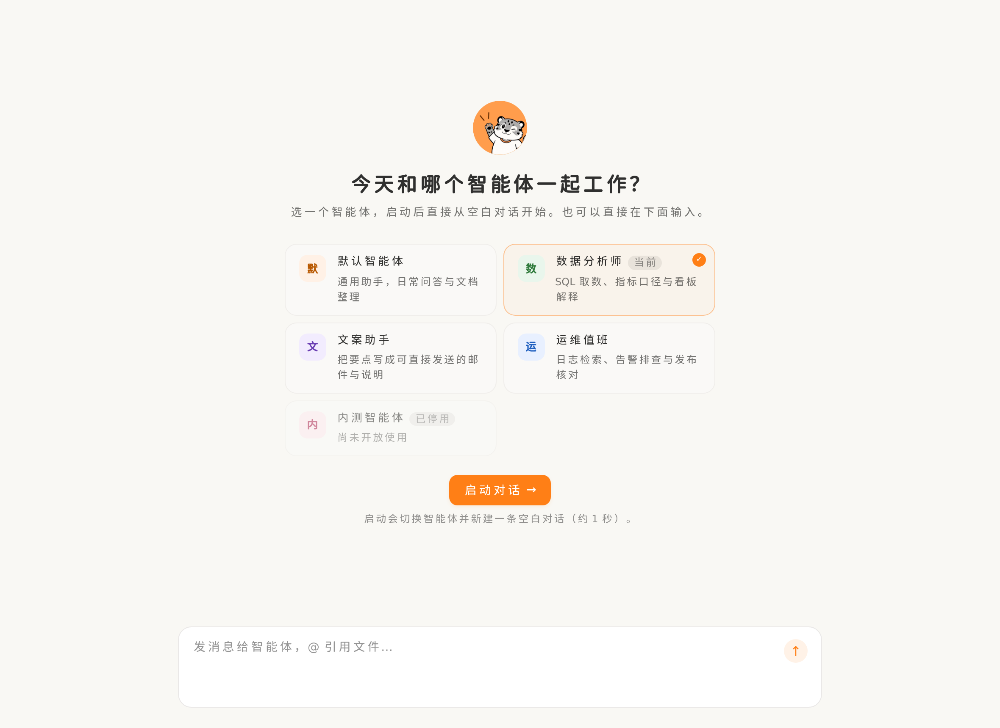
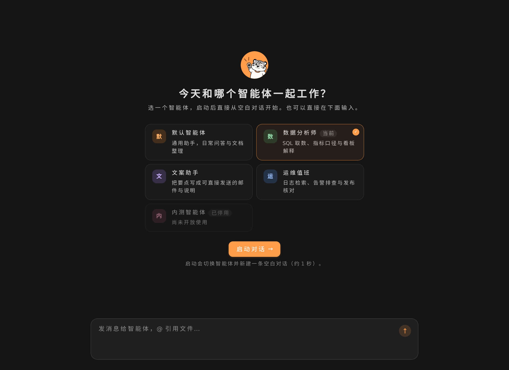

# QwenPaw Startup Page

把聊天首页变成一张"启动页"：从卡片里挑一个智能体，点「启动对话」，直接进入一条全新的空白对话。

| 亮色 | 暗色 |
| --- | --- |
|  |  |

## 它做了什么

- 用 `chat.welcome.render` 接管聊天欢迎区，渲染两列智能体卡片（头像 + 名称 + 一句话描述）。
- 选中卡片后点「启动对话」→ 写入宿主的智能体/待新建对话标记 → 跳到 `/chat` 进入空白会话。
- 每次新对话都会出现：启动页落下的那条空白对话用宿主原生欢迎区，之后本标签页里再点「新建对话」（在聊天页里点，或从别的页面点）启动页都会回来。
- 输入框不被接管：用户想直接打字就打字，用的是宿主当前智能体。
- 只有一个可用智能体（或接口没返回任何智能体）时不显示启动页，直接回到原生欢迎区。
- 已停用的智能体显示但不可选；当前智能体预选并标「当前」。
- 选中的就是当前对话正在用的智能体时，启动按钮变灰、文案变成「当前智能体」，下方提示改为「直接在下面输入即可」—— 没有可切换的东西就不给一个假的启动动作（Enter / Space 同样不触发）。
- 暗色/亮色、中/英、控制台字号设置全部跟随宿主：用 `--app-*` token、宿主 `antd` 与 `host.useLocale/useTheme`。

## 安装

**离线安装包**（推荐）：从 [Releases](https://github.com/Ligandlly/qwenpaw-startup-plugin/releases) 下载 `qwenpaw-startup-page-<version>.zip`。
插件是纯前端，包里已内置 `dist/index.js`，安装时不需要联网、不需要 npm。

```bash
# QwenPaw 正在运行：直接给 zip，会走 API 热安装
qwenpaw plugin install ./qwenpaw-startup-page-0.1.0.zip

# QwenPaw 未运行（完全离线）：先解压再指向目录
unzip qwenpaw-startup-page-0.1.0.zip
qwenpaw plugin install ./qwenpaw-startup-page
```

**从源码安装**：

```bash
npm ci
npm run build                      # 产出 dist/index.js（插件入口，已提交）
qwenpaw plugin install . --force   # QwenPaw 运行时支持热加载
```

装好后打开（或刷新）控制台：进入聊天页就会看到启动页；启动之后每条新的空白对话也都会再看到它。

## 已知取舍

- **切换智能体那一下会整页重载一次。** 这是刻意选择：不重载就没法在同一个标签页里"退回"宿主原生欢迎区，而且换智能体在宿主里本来就要重新拉取会话。启动标记写在 `sessionStorage`，只对重载后落下的那条对话生效 —— 下一次新建对话时清掉标记并重新注册，所以「新建对话」不会再被旧标记挡住。
- **不展示模型/工具信息。** 卡片只有身份（头像、名称、描述）与状态，避免把启动决策变成模型参数决策。
- **依赖宿主的 UI 契约。** 复用了 `qwenpaw-agent-storage`、`qwenpaw-last-used-agent`、`qwenpaw_pending_new_chat` 三个持久化键与 `chat.welcome.render` 槽位；宿主改这些键时要跟着改（见 `docs/architecture.md` 的契约表）。

## 开发

```bash
npm run check      # build + typecheck + test
npm run test       # vitest（jsdom）
npm run package    # 打离线安装包 → release/qwenpaw-startup-page-<version>.zip + .sha256
npm run preview    # 生成 .preview/index.html：不启动后端也能看真实组件
```

预览页复用了 `../QwenPaw/console/src/styles/tokens.css`（可用 `QWENPAW_CONSOLE=/path/to/console` 指定），
`?theme=dark`、`?lang=en` 可切暗色与英文。

## 发布新版本

```bash
npm version 0.2.0 --no-git-tag-version           # 改 package.json / package-lock.json
npm pkg get version                              # 顺手确认一下
node -e 'const f="plugin.json",m=require("./"+f);m.version="0.2.0";require("fs").writeFileSync(f,JSON.stringify(m,null,2)+"\n")'
git commit -am "chore: release v0.2.0"           # 两个 version 必须在同一个提交里
git push origin main
git tag v0.2.0                                   # 注意：npm version 没带 tag
git push origin v0.2.0                           # 单独推 tag，CI 才会打 Release
```

`plugin.json` 的 `version` 与 tag 必须一致（CI 会校验，不一致会让 package job 直接失败）——`npm version --no-git-tag-version` 只动 `package.json`，清单要手动跟上。Release 里会自动附上 zip 与 `.sha256`。
注意：`git push --follow-tags` 把分支和 tag 一次性推时 GitHub 只跑分支那一次，tag 要单独推。

## 结构

| 路径 | 作用 |
| --- | --- |
| `plugin.json` | 插件清单（`type: frontend`，入口 `dist/index.js`） |
| `src/index.tsx` | 注册/回收 `chat.welcome.render`；启动后的那条对话让位，等下一个「新建对话」信号再注册 |
| `src/StartupWelcome.tsx` | 启动页主体：加载/失败/就绪三态、选中、键盘、启动 |
| `src/AgentCard.tsx` | 智能体卡片（radiogroup 语义、停用态、当前标记） |
| `src/agents.ts` | `/api/agents` 读取、排序、默认选中 |
| `src/launch.ts` | 启动链路：storage 合并写入 → 待新建对话标记 → 跳转 |
| `src/styles.ts` | 注入样式，全部用 `--app-*` token |
| `docs/` | 需求、架构、模块设计三份规格 |
